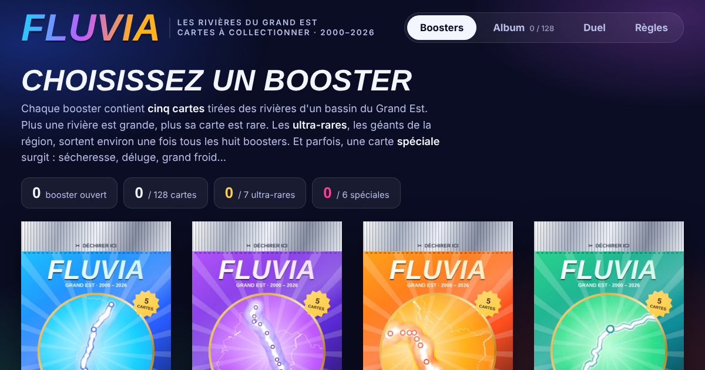

# Fluvia

**Les rivières du Grand Est en cartes à collectionner.** Ouvrez des boosters, collectionnez 122 rivières et 6 phénomènes, retournez les cartes, affrontez-vous en duel.

▶ **Jouer : https://parisonraphael7-prog.github.io/fluvia/**

Projet réalisé pour le concours de datavisualisation **DataGrandEst 2026** par Raphaël Parison (Bachelor Chef de projet digital, Ynov Lille).

- Données : uniquement celles du concours (Hub'Eau, Météo-France, BD Topage / Carthage), débits hebdomadaires de 266 stations de 2000 à 2026.
- Rareté d'une carte : débit habituel de la plus grande station de la rivière.
- Attributs (puissance, résistance à la sécheresse, tempérament en crue) : rang de la rivière parmi les 122.
- Tout le jeu tient dans un seul fichier `index.html` ; la collection est conservée dans le navigateur.
